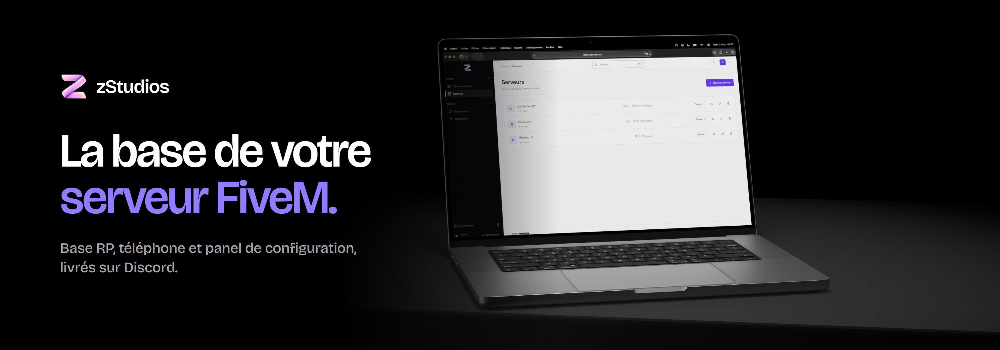

  

<h1 align="center">Votre serveur FiveM, prêt à ouvrir.</h1>

  La base, les outils, le panel. 
  Le serveur qui décolle, c'est vous qui le faites.

  &nbsp;
  &nbsp;
  &nbsp;
  

 

## À propos

zStudios crée des produits pour les serveurs FiveM Rôleplay. Monter une base propre, stable et jouable prend un temps fou : chez nous, c'est déjà fait. Vous configurez depuis le panel, vous lancez, et les mises à jour et le support suivent, au lieu de tout maintenir seul.

## Ce qu'on propose

**Base RP.** Une base FiveM complète pour lancer un serveur roleplay sans repartir de zéro. Quatre offres (Start, Pro, Elite, Network), en mensuel, 3 mois ou annuel.

**Téléphone.** Un smartphone RP complet : appels, messages, banque, réseaux et photos. En option, inclus avec Elite et Network.

**Panel.** Identité du serveur, slots, langue, boutique in-game, licences, logs et CDN : tout se règle depuis une interface, sans toucher un seul fichier.

**Services.** Installation et pré-configuration par l'équipe, et projets sur mesure pour les besoins qui sortent du cadre.

## Comment ça marche

Vous choisissez votre formule, votre clé arrive automatiquement en DM Discord avec le rôle client, puis vous lancez votre serveur avec la documentation pas à pas et le panel. De l'achat au serveur lancé : trois étapes, moins de 30 minutes.

Avant d'acheter, la vraie base tourne en live sur un serveur de démo public : vous pouvez la tester en jeu gratuitement.

## Support

Sur Discord. Vous posez votre question, un humain vous répond vraiment : pas de bot, pas de réponse copiée-collée. Les mises à jour et les patch notes sont incluses dans toutes les offres.

   
  

 

  <a href="https://zstudios.eu">Site</a>&nbsp;·&nbsp;
  <a href="https://zstudios.eu/shop">Boutique</a>&nbsp;·&nbsp;
  <a href="https://zstudios.eu/docs">Documentation</a>&nbsp;·&nbsp;
  <a href="https://panel.zstudios.eu">Panel</a>&nbsp;·&nbsp;
  <a href="https://zstudios.eu/mentions-legales">Mentions légales</a>&nbsp;·&nbsp;
  <a href="https://zstudios.eu/terms-of-sale">CGV</a>&nbsp;·&nbsp;
  <a href="mailto:contact@zstudios.eu">Contact</a>

  © 2026 zStudios. Tous droits réservés. 
  zStudios n'est pas affilié à Take-Two ni à Rockstar North Interactive, ni approuvé par eux.

